


  
  
  
  

  
  

 

  <picture>
    <source media="(prefers-color-scheme: light)" srcset="./assets/sections/01-about-light.svg" />
    
  </picture>

I design and build products that feel fast, look premium, and actually solve something. Currently shipping SaaS at <b>Kumi Labs</b>, after a full-stack internship at <b>Haze Media IT</b> — B.Tech at Gautam Buddha University.
I like owning the whole slice: Flutter / React on the surface, FastAPI / Node.js underneath, PostgreSQL and MongoDB when the data model demands it.

  

 

  <picture>
    <source media="(prefers-color-scheme: light)" srcset="./assets/sections/02-work-light.svg" />
    
  </picture>

  <a href="https://maportt.netlify.app/"></a>
  <a href="https://maportt.netlify.app/"></a>

  <a href="https://github.com/DeveshPant5/LALIT-major"></a>
  <a href="https://github.com/DeveshPant5/sessionbookingfront"></a>

  <a href="https://github.com/DeveshPant5/Thrift-app-front-end-"></a>
  <a href="https://github.com/DeveshPant5/internship-assignment-B2C"></a>

  
    <b>SOURCE</b> &nbsp;
    Session Booking <a href="https://github.com/DeveshPant5/sessionbookingfront">front</a> / <a href="https://github.com/DeveshPant5/sessionbookingback">back</a> &nbsp;·&nbsp;
    Thrift <a href="https://github.com/DeveshPant5/Thrift-app-front-end-">app</a> / <a href="https://github.com/DeveshPant5/thrift-app-backend">api</a>
    &nbsp;&nbsp;│&nbsp;&nbsp;
    <b>MORE</b> &nbsp;
    <a href="https://github.com/DeveshPant5/reconsys">reconsys</a> ·
    <a href="https://github.com/DeveshPant5/youtube-clone-">YouTube clone</a> ·
    <a href="https://github.com/DeveshPant5/solar-system">CSS solar system</a> ·
    <a href="https://maportt.netlify.app/">full archive on maportt ↗</a>
  

 

  <picture>
    <source media="(prefers-color-scheme: light)" srcset="./assets/sections/03-stack-light.svg" />
    
  </picture>

  

  

 

  <picture>
    <source media="(prefers-color-scheme: light)" srcset="./assets/sections/04-telemetry-light.svg" />
    
  </picture>

  

 

  <picture>
    <source media="(prefers-color-scheme: light)" srcset="./assets/sections/05-grid-light.svg" />
    
  </picture>

  <picture>
    <source media="(prefers-color-scheme: dark)" srcset="https://raw.githubusercontent.com/DeveshPant5/DeveshPant5/output/github-contribution-grid-snake-dark.svg" />
    <source media="(prefers-color-scheme: light)" srcset="https://raw.githubusercontent.com/DeveshPant5/DeveshPant5/output/github-contribution-grid-snake.svg" />
    
  </picture>

 

  <picture>
    <source media="(prefers-color-scheme: light)" srcset="./assets/sections/06-connect-light.svg" />
    
  </picture>

  <a href="mailto:dev.deveshpant@gmail.com"></a>
    
  

<!-- Artwork: edit scripts/build-assets.mjs, then run `node scripts/build-assets.mjs`. Stats + snake are rebuilt daily by .github/workflows/snake.yml. -->
